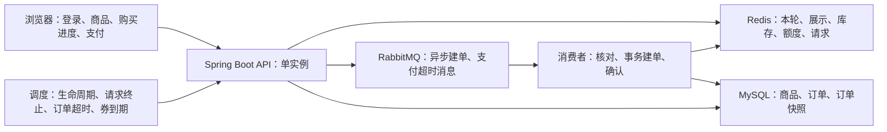
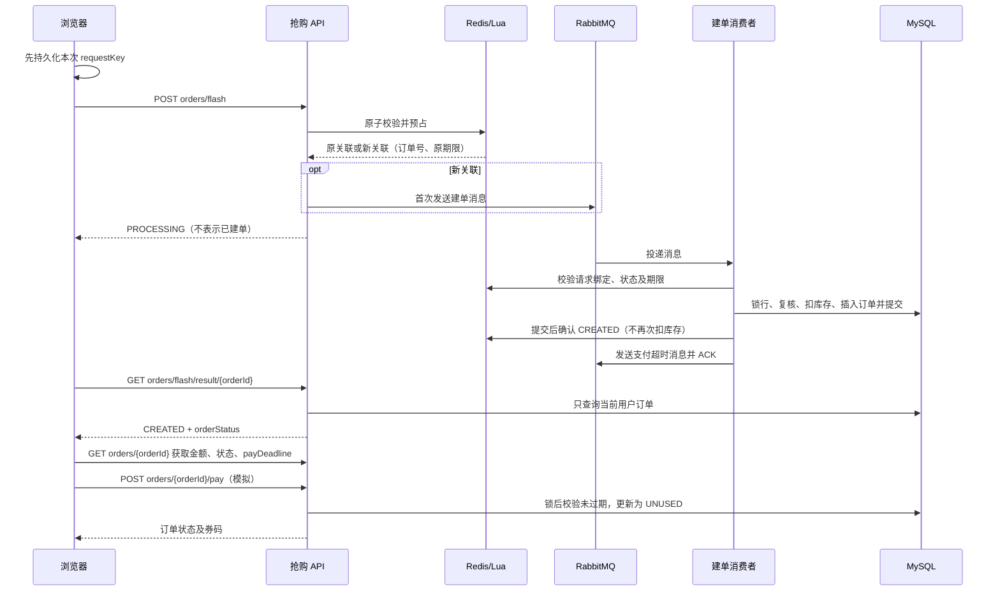
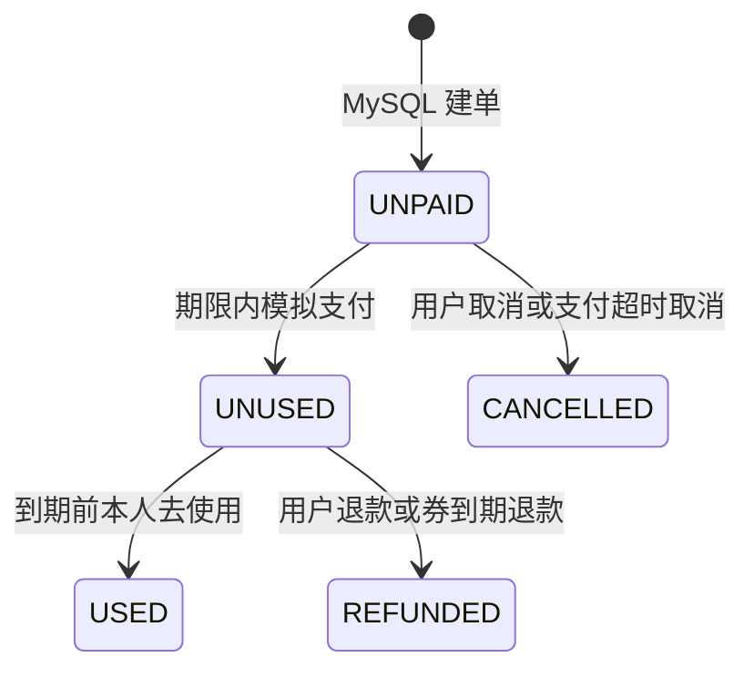

# 抢购系统技术说明：设计、流程、边界与验收

> 实施日期：2026-10-12；验收更新：2026-10-13（Asia/Shanghai）。原规划：`D:/codespace/TikCookie/docs/plan/2026-10-12-redis-mq-flash-sale.md`。
> 本文描述本地功能分支，不表示已合并或已部署。真实服务器配置与发布仍由部署流程确认。

> 文档补充核对：2026-10-13。面向开发、测试和部署人员，描述当前工作区实现，不是待实现的设计方案。普通用户请先阅读 [抢购用户使用指南](FLASH_SALE_USER_GUIDE.md)。“抢购”“秒杀”均指 FLASH 商品。

## 阅读导航

- 第 0 节：架构、组件分工、抢购时序与状态。
- 第 1 节：库存/限购、商品生命周期与能力边界。
- 第 2–4 节：启动配置、接口契约、Redis 与 MQ 资源。
- 第 5–6 节：故障核对、恢复限制、测试记录与发布验收。
- 第 7 节：源码定位与文档维护约定。

## 0. 系统设计与完整抢购流程

### 0.1 定位与术语

当前方案是 **Vue 浏览器端 + 单实例 Spring Boot + Redis + RabbitMQ + MySQL** 的教学演示抢购闭环。一单购买一件商品，支付、退款及本人“去使用”为教学模拟，不连接真实支付渠道或商家扫码核销系统。目标是处理并发预占、异步建单、限购及超时取消，不宣称生产级高可用或已经达到某个 QPS。

| 术语 | 含义 | 不能据此推断 |
|---|---|---|
| 本轮 | Redis current 集合中的商品 ID；启动时追加的新商品进入本轮 | 不是按自然日或每小时自动重置的活动 |
| 可展示 | 本轮、缓存完整、未暂停、上架、在时间窗内且 Redis 剩余库存大于 0 | 不保证该用户还有额度，也不保证点击时仍有库存 |
| 预占 | Lua 扣 Redis 库存、占用户额度、绑定请求键与订单号 | 尚未证明 MySQL 中有订单 |
| 建单 | MySQL 事务提交待支付订单并扣减数据库库存 | 不表示支付或核销成功 |
| 释放 | 确认未建单后终止，或待支付订单取消提交后，幂等回补预占 | 不允许在结果不明时直接加回库存 |

### 0.2 组件分工与数据来源

设计取舍：Redis/Lua 把库存与额度校验、预占合为一次原子操作；RabbitMQ 把数据库建单移出提交接口的同步路径；MySQL 事务及条件更新保护最终订单与库存。此拆分不等于跨 Redis/MQ/MySQL 的原子事务，依赖保留请求绑定、幂等消费和锁内核对来处理结果不确定性，不能推断为消息绝不丢失或订单必定生成。



| 组件 | 责任与关键约束 |
|---|---|
| 前端购买流程 | POST 前按用户/商品保存意图；普通重试复用 requestKey，主动再买才生成新键；查到建单后读取真实订单 |
| FlashDemoInitializer | 门禁关闭时退役旧演示商品、核对旧请求、追加新轮并初始化 Redis；初始化完成后开放抢购和独立消费者 |
| FlashCacheService + Lua | 查询可售 FLASH 商品；原子预占、确认、释放；个人额度不写入共享商品资料 |
| FlashOrderService | 首次预占后发布建单消息；消费校验请求绑定，事务提交后确认 Redis；结果只查询本人 MySQL 订单 |
| FlashRequestCoordinator | 256 个按商品 ID 映射的 JVM 分片锁；不同商品可能映射到同一锁，不是分布式锁 |
| OrderServiceImpl | 数据库时间窗/限购复核、条件扣库存、订单快照；支付、取消、退款和使用状态迁移 |
| 消费者与调度 | 手动 ACK、异常不自动重入队；请求终止扫描、支付超时消息与数据库扫描协作兜底 |

**两份库存不是随时相等。** Redis 库存表示还能接受多少预占，MySQL 库存表示建单后剩余的业务库存；排队期间 Redis 已扣、MySQL 尚未扣。不能看到差值就直接用一份覆盖另一份。订单存在与状态以 MySQL 为准；抢购资格以本轮 Redis 完整数据及 Lua 校验为准。FLASH 列表/详情不走 Elasticsearch，普通商品搜索仍由 Logstash 同步 ES。

### 0.3 正常抢购时序



1. 游客可浏览；提交、结果查询和订单操作必须登录。商品详情携带 token 时验证身份，以该身份查询个人额度。
2. 同键重试优先返回原绑定，即使商品已售罄或原请求已终止，也不会重新预占或延长期限。首次预占后期限为 30 秒，由服务端返回截止时间。
3. 只有新预占发布建单消息；投递异常/响应丢失保留原请求，不通过重试重新发消息。MQ confirm 是投递证据，不是建单证据。
4. 消费者在商品协调锁内校验绑定及预占状态；数据库事务按商品行→订单行顺序加锁，复核上架、活动时间、本人未取消订单数量及库存。重复消息遇到已有同一订单时核对关联，不再次建单或扣库存。
5. 事务提交后才确认 Redis。异常时通过新事务锁商品并当前读订单；确认未建单的可终止请求才释放，无法核对则暂停商品、保留预占。
6. 收到 CREATED 后仍须读取真实订单：orderStatus 可能已经是 CANCELLED、UNUSED 等，不保证仍可支付。
7. 支付期限从数据库建单时间起计算，默认 15 分钟；券有效期从支付成功时间加商品 validDays 计算。活动结束阻止新购买，不自动取消已经创建且仍在支付期限内的订单。

### 0.4 两套状态与三个时间边界

| 层级 | 状态与迁移 | 含义 |
|---|---|---|
| Redis 请求 | PENDING → CREATED；核对未建单后 PENDING → TERMINATED；数据库取消后 PENDING/CREATED → CANCELLED | 内部处理及幂等释放依据，不直接暴露失败原因 |
| 提交响应 | PROCESSING | 已有请求绑定；同键重试仍返回此状态，不回传内部终态 |
| 结果响应 | CREATED / NOT_CREATED | 此刻是否查到本人数据库订单；不存在和非本人统一 NOT_CREATED |
| 前端进度 | PROCESSING / UNKNOWN / WAIT_EXPIRED | 等待、暂无法确认、停止自动查询；均不等于服务端已释放 |



- 活动时间窗：flashStartTime ≤ 服务端当前时间 < flashEndTime。默认每秒调度一次首次上架，不承诺开抢瞬间列表立刻更新。
- 请求期限：首次预占 +30 秒。扫描还要锁定并核对，提交/消息/网络结果可能待确认；不承诺第 30 秒恰好释放，前端停止查询不是安全失败。
- 支付期限：payDeadline，默认建单 +15 分钟。接口锁后再次校验；MQ TTL 和扫描允许延迟，暂时仍显示待支付也不能超期付款。

## 1. 业务边界

- **仅单实例 Spring Boot**。按商品分片的 JVM 锁覆盖建单、取消、终止及数据库提交；不是分布式一致性方案。
- 不增加数据库表、字段、索引；原主键/历史订单保留。所有新订单由一个固定节点 `(worker=1, datacenter=1)` 的 MyBatis-Plus 雪花生成器发号，实体 `IdType.INPUT`，HTTP ID 始终字符串。
- 普通商品同步下单；FLASH 只能走 Redis 预占 → MQ → MySQL，不能通过普通下单绕过缓存。
- 未开抢不展示；本轮且缓存完整时首次自动上架。售罄从展示索引隐藏但不改上下架状态；本轮窗口内上架商品回补恢复展示；人工下架不被调度反复恢复；结束及旧轮不得恢复售卖。
- 开抢后禁止人工编辑全部资料；上下架和正常交易库存/销量不属于资料编辑。
- 限购包括排队预占及 UNPAID/UNUSED/USED/REFUNDED，取消/未建单终止才释放；退款/使用不回库存或限购。
- 请求排队从首次预占起 30 秒，重试不延期，终止标记不自动删除；无结果缓存、请求表、Outbox、自动异常重试、限流/反作弊或恢复平台。

### 1.1 库存、额度与销量规则

限购按 **用户 + 商品 ID** 计算，不按浏览器或支付次数，也不是跨轮全局限购。重启追加的新商品有新 ID，旧订单仍保留。

| 事件 | Redis 库存 | MySQL 库存 | 本人额度 | 已售数 |
|---|---|---|---|---|
| 首次预占 | −1 | 不变 | 占用 1 个 | 不变 |
| 提交建单（UNPAID） | 不再次扣减 | −1 | 保持占用 | 不变 |
| 同键重试/重复建单消息 | 不重复变更 | 不重复变更 | 不重复变更 | 不变 |
| 核对未建单并终止 | 幂等 +1 | 不变 | 释放 1 个 | 不变 |
| 待支付订单取消/超时取消 | 数据库提交后幂等 +1 | 状态迁移成功时 +1 | 释放 | 不变 |
| 支付成功（UNUSED） | 不变 | 不变 | 保持占用 | +1 |
| 去使用（USED） | 不变 | 不变 | 保持占用 | 不变 |
| 主动退款/券到期退款（REFUNDED） | 不变 | 不变 | **不释放** | −1 |

Redis 回补以交易缓存可核对且更新成功为前提。取消已提交而 Redis 更新失败时，数据库取消结果仍有效，商品暂停等待核对，不能重复增加数据库库存。

### 1.2 商品及能力边界

- 未开抢不展示；本轮完整商品到点获得一次自动上架机会。售罄仅隐藏展示索引；活动中取消回补且仍上架、未暂停时恢复展示。
- 开抢后的人工下架不会被调度反复上架；结束、旧轮或缓存不完整时不得恢复售卖。
- 开抢后所有资料冻结，包含价格、图片、名称、库存配置、时间与限购；上下架及正常交易库存/销量走专用流程。
- 本轮由启动器追加的三件演示商品组成。内部接口创建 FLASH 商品只写数据库并登记类型，**不等于已加入本轮并初始化交易缓存**；当前不是通用活动发布平台。
- 不支持一次购买多件、购物车合并、多后端实例、分布式事务、自动无损恢复、严格公平排队、限流/验证码/反作弊、生产吞吐或可用性 SLA、真实支付退款或商家核销。
- 没有单独的用户“取消排队请求”接口；取消接口只作用于已经创建的待支付订单。隔离测试不是容量压测结论。

## 2. 启动与参数

默认 `DSS_FLASH_ENABLED=true`。启动门禁关闭，秒杀消费者 `autoStartup=false`，流程为：

1. 校验演示专用店铺 2001/2002/2003 的所有权；非预期店名拒绝启动，避免误用无关店铺。
2. 只下架这些店铺的旧 FLASH 商品，不删除商品、订单、用户、收藏或评价。
3. 清理**本轮/展示两个索引**，核对并终止旧未建单请求，已有订单确认或处理取消，不清空交易数据或 MQ。
4. 同一 JDBC 事务执行 classpath `db/flash-demo-append.sql`，商品不传 ID，以 `LAST_INSERT_ID()` 回读三个新 ID。
5. 加载类型索引，初始化新轮资料/独立库存/额度容器，再开启消费者和运行门禁。任何失败均不开放半初始化抢购。

集中演示参数在 SQL：牛肉面 100 分/库存 10/限购 1；提拉米苏 1680 分/库存 20/限购 2；电影票 1990 分/库存 30/限购 2。三个商品共用 `@demo_now`，开抢 +60 秒，持续 30 分钟。图片复用仓库 OSS 清单中已上传保留的 product_1/2/3 实际 ObjectKey（不写完整 URL）；2026-10-13 公开 HEAD 检查三张图均 HTTP 200 / image/jpeg。部署使用其他 Bucket 时需提供对应对象，不在启动时自动上传。

| 环境变量 | 默认 | 作用 |
|---|---|---|
| DSS_FLASH_ENABLED | true | 启用启动追加、商品/请求调度及独立秒杀监听器 |
| DSS_FLASH_MQ_PREFIX | dss.flash | MQ 名称空间，部署单实例使用同一稳定前缀；集成测试使用随机前缀 |
| DSS_FLASH_LIFECYCLE_INTERVAL | PT1S | 首次上架/结束下架扫描 |
| DSS_FLASH_REQUEST_TIMEOUT_INTERVAL | PT1S | 30 秒请求终止扫描，单批 100 条 |
| DSS_JOB_ENABLED | true | 原订单超时/到期退款扫描兜底 |
| DSS_JOB_ORDER_TIMEOUT_INTERVAL | PT1M | 数据库超时扫描 |
| DSS_JOB_VOUCHER_EXPIRE_INTERVAL | PT1M | 券到期退款扫描 |
| DSS_ORDER_PAY_TIMEOUT_MINUTES | 15 | 数据库支付截止，支付接口锁后再次校验 |

注意：已有 `.env` / 服务器环境值会覆盖新默认值。本次不改真实环境文件，部署时显式确认 `DSS_FLASH_ENABLED=true`、`DSS_JOB_ENABLED=true`；若保留旧 `DSS_JOB_ENABLED=false`，数据库超时扫描兜底不会注册。

消费者从独立 factory 创建，不继承全局 retry advice；其他模块 MQ 配置不关闭。只有明确 returned message 才触发投递拒绝核对，连接关闭产生的 synthetic nack 不视为确定未投递；其他不确定情况保留关联，由到期任务安全核对。到期任务每轮最多100条、逐请求隔离异常并分页回卷，坏请求保留但不永久阻断后续商品。搜索 Java/MQ 同步仍禁止，Logstash 保持原写入方；搜索商品过滤 NORMAL，抢购列表/详情不走 ES。

### 废弃旧破坏性周期

部署本分支前，必须停止并禁用旧 `tikcookie-flash-demo.timer`，并停止可能尚在运行的 `tikcookie-flash-demo.service`：

```sh
sudo systemctl disable --now tikcookie-flash-demo.timer
sudo systemctl stop tikcookie-flash-demo.service
```

不要调用 `deploy/scripts/reset-flash-demo.py` 或 `deploy/sql/flash-demo-reset.sql`；它们是此前未提交的部署工作，本方案不依赖，也不自动执行/删除。启动追加已经取代每小时重置。重启会追加新一轮，禁止多实例并发播种。

## 3. 接口契约

统一 Result 包装保持 `{code,msg,data}`，时间 `yyyy-MM-dd HH:mm:ss`（上海时间）。

订单操作携带 `Authorization: Bearer <token>`，身份只从认证上下文取得。业务 ID 在 JSON 与前端保持字符串，不转 JavaScript Number；金额为整数分。HTTP 200 不等于业务成功，须检查包装层 code=0。

| 方法与路径（均以 /api/v1 为前缀） | 认证 | 用途 |
|---|---|---|
| GET /products/flash | 公开 | 本轮可展示商品，不按个人额度过滤 |
| GET /products/{productId} | 可选；传 token 必须有效 | Redis 详情与已登录用户个人额度 |
| POST /orders/flash | 登录 | 预占并受理请求 |
| GET /orders/flash/result/{orderId} | 登录 | 本人是否已建单 |
| GET /orders/{orderId}、GET /orders | 登录 | 本人订单详情/列表 |
| POST /orders/{orderId}/pay、POST /orders/{orderId}/cancel | 登录 | 模拟支付、取消待支付订单 |
| POST /orders/{orderId}/refund、POST /orders/{orderId}/use | 登录 | 模拟退款、本人教学核销 |

### 个人购买额度

| 字段 | 类型 | 含义 |
|---|---|---|
| limitPerUser | int | 每用户每商品的限购数量 |
| purchaseCount | int / null | 当前本人已占额度，含排队预占 |
| remainingQuota | int / null | 剩余额度，最小为 0 |
| purchaseLimitReached | boolean / null | 是否达到限购 |

登录用户的 FLASH 详情除 limitPerUser 外返回 purchaseCount（已占用数量，含排队，不是已支付件数）、remainingQuota=max(0, limitPerUser-purchaseCount)、purchaseLimitReached。游客/NORMAL 的三个个人字段为 null。达到上限仍能读取详情；公开商品查询设置 Cache-Control: private, no-store，个人字段不写入共享缓存。

前端未取得商品及额度前不允许购买；达到上限的两个按钮灰显，点击只提示“限购【N】件，您已达到购买上限”，不发新请求。快照可能变化，Lua 才是预占最终裁决，收到 103011 也切换为上限提示。详见 [接口协作约定](API_CONTRACT.md)。

### POST /api/v1/orders/flash（登录）

```json
{"productId":"123","requestKey":"550e8400-e29b-41d4-a716-446655440000"}
```

requestKey 为 16–128 位 ASCII 字母/数字/下划线/连字符；同一购买重试原 key，主动再买新 key。不能改绑用户或商品。

```json
{"code":0,"msg":"ok","data":{"orderId":"900000000000000001","state":"PROCESSING","acceptedAt":"2026-10-13 10:00:00","queueDeadline":"2026-10-13 10:00:30"}}
```

拿到 orderId **不等于订单已创建**。MQ confirm/return 判断投递，不判断建单。投递结果不确定仍保留原关联，不重新发布。

### GET /api/v1/orders/flash/result/{orderId}（登录）

仅查 MySQL `orders.id=orderId AND orders.user_id=当前用户`，无 Redis/ES 结果读取。

```json
{"code":0,"msg":"ok","data":{"state":"CREATED","orderId":"900000000000000001","orderStatus":"UNPAID"}}
```

未建单或非本人统一 `{ "state": "NOT_CREATED" }`，不泄露订单状态，也不提供异步失败原因。

前端认证 token 与用户身份存入同一个本地记录 `tikcookie:auth:v1`，部分保存失败拒绝认证；旧版分离 token/userInfo 不再用于认证，升级后需重新登录，旧购买意图保留。前端发 POST 前按用户/商品持久化 key；刷新/响应丢失及多个已打开页面的普通重试复用。每秒查询，按服务端 queueDeadline 停止自动查询；NOT_CREATED、截止或网络超时不证明安全失败。保留手动查晚到订单与主动再买入口。CREATED 后读取真实订单进入支付，倒计时来自 payDeadline，支付失败不跳成功页。

### 商品与生命周期

- GET `/api/v1/products/flash`：Redis 展示索引，只返回进行中、本轮、上架、有货且数据完整商品。
- GET `/api/v1/products/{id}`：已知 FLASH 走 Redis，缓存缺失返回不可用，不重建交易库存。启动加载商品类型索引；未知 ID 仅查询类型，不将 FLASH 当 NORMAL 回源售卖。
- 普通下单/支付/取消/退款/使用 URL 不变。支付不再次扣库存；取消 DB UNPAID→CANCELLED 成功后库存 +1，再幂等回补 Redis。Redis 更新失败返回已发生的取消状态并暂停商品，不再次增加 MySQL 库存。
- MQ TTL 等待是延时机制，不精确计时器；超时执行再次检查 status/payDeadline。DB 扫描兜底，支付接口本身拒绝过期。

### 错误与重试约定

| 业务码/响应 | 含义 | 客户端处理 |
|---|---|---|
| 103002 | 下架或不在可访问时间窗 | 刷新详情/列表，不绕过抢购入口 |
| 103008 / 103009 | 未开始 / 已结束或旧轮 | 等待开抢并刷新，或停止新购买 |
| 103010 | 已抢光 | 停止新购买；此前请求仍查原结果 |
| 103011 | 超过限购 | 提示真实限购；取消已建待支付订单才可能释放名额 |
| 40000 | 参数错误或请求键改绑 | 检查字符串 ID、键格式，不改绑原键 |
| HTTP 401 / 40100 | 登录无效或过期 | 原购买账号重新登录，恢复原意图 |
| 104001 / 104002 / 104003 | 本人订单不存在 / 状态不允许 / 支付过期 | 刷新订单，不强制进入成功页 |
| HTTP 500 / 50000、网络超时 | 不可用或结果未确认 | 保留原键/订单号，查本人订单，不认定无订单 |
| NOT_CREATED | 当前未查到本人订单 | 不作为失败终态或额度已释放的证据 |

消费者阶段的业务拒绝不通过结果接口返回详细原因，该接口没有 FAILED 状态。首次提交的确定业务拒绝与预占后的不确定结果要区分，不能定义成“30 秒后必定抢购失败”。

## 4. Redis 与 MQ 资源

默认 Redis key：`dss:flash:current`、`visible`、`product:<id>`、`stock:<id>`、`quota:<id>`、`request:<sha256(requestKey)>`、`expiry`、`orders`。请求含用户/商品/字符串订单号/首次时间/期限/state/released；无用户手机、token、密码。额度容器 `_ready` 与资料 `auto` 用于检查数据完整性；缺失不解释为零额度或尚未上架。

Lua 预占/确认/释放先验证键类型和规范整数，再修改；重复预占优先返回绑定，确认不重复扣 Redis；TERMINATE 不能释放 CREATED；CANCEL 仅数据库取消提交后使用。脚本不扫描请求，不把 Lua 原子性描述为回滚能力。

默认 MQ：`dss.flash.direct` → `dss.flash.orders`；`dss.flash.payment.wait`（15 分钟 TTL）死信路由到 `dss.flash.payment.timeout`。消息仅请求散列/商品/用户/订单 ID，不包含 token。手动确认发生在服务完成提交/核对后，异常拒绝不重入队；连接中断可能重复投递，数据库/预占幂等处理必须保留。

当前独立监听器为单消费者、prefetch=20，手动确认，不继承全局 retry advice。等待队列 TTL 固定为 900000 毫秒（15 分钟），**不会随 DSS_ORDER_PAY_TIMEOUT_MINUTES 自动变化**。更改数据库支付期限时不能只依赖这条消息：提前到达会再次检查截止时间并跳过，较晚到达也不影响接口拒绝过期支付，数据库扫描须保持启用。抢购 Redis 键不是 Redis Cluster 多槽方案，不宣称支持 Cluster 部署。

## 5. 故障与发号限制

- Redis 异常、缓存缺失或严重数据丢失暂停商品，**无同步 MySQL 抢购降级**，无库存/额度自动回源重建。
- 不确定提交通过 REQUIRES_NEW 事务先锁商品行再当前读订单，核对无法完成则暂停并保留预占。建单/终止/取消模板不加入外层事务，确保提交在商品协调锁释放前完成。已提交订单不能当未建单失败补偿。
- 请求终止、已建单和释放记录不能设置 30 秒自动删除。此演示无交易记录自动清理，运行久需人工评估 Redis 容量。
- 固定雪花节点仅一个进程使用，进程内回拨/发号异常拒绝请求；部署须同步时钟，重启前确认时钟不早于上次发号时间。当前不承诺跨主机迁移、系统时钟被大幅回拨后重启的无损发号恢复；ID 主键冲突会回滚事务，不回退到自增。
- 不对旧轮缺失缓存建可售缓存。恢复允许停机人工核对或重新启动追加新轮，历史 DB 记录保留，不承诺无损自动恢复。

### 人工核对与恢复（技术人员）

1. 先暂停相关商品/停止新购买，保存商品 ID、用户 ID、原请求键、订单号、受理及异常时间。不记录或索取 token、密码、验证码。
2. 用受控运维工具只读核对 MySQL 订单、Redis 请求绑定/状态/released、库存/额度及 MQ 日志。无法读取关键记录时保持暂停，不能把“读不到”当成“未建单”。
3. 已有 UNPAID/UNUSED/USED/REFUNDED 订单不能按失败请求释放；CANCELLED 核对数据库回补是否提交、Redis 是否释放；确认无订单的请求才有资格走终止核对。不要直接加库存或删除请求标记。
4. 当前没有自动恢复按钮/平台。停机修复需单独确认方案；重新启动是核对旧请求并追加新轮，不是原活动无损续跑。旧请求核对失败也可能拒绝开放新轮。
5. 记录处置和再次开放证据。不清业务 Redis/全局 MQ，不删除历史订单，不运行旧 reset 脚本。

发布/演示检查清单：

- [ ] 只有一个后端使用固定发号节点，时钟及上海时区配置一致。
- [ ] 显式核对 DSS_FLASH_ENABLED、DSS_JOB_ENABLED 为 true、稳定 MQ 前缀；旧 timer/service 已停用。
- [ ] 后端先发布、前端后发布；旧认证记录重新登录，不清未确认购买意图。
- [ ] 初始化成功，记录三件新商品 ID；开抢后刷新可见，目标 Bucket 图片可显示。
- [ ] 验证排队→本人结果→详情→模拟支付；核对金额、字符串 ID、payDeadline。
- [ ] 验证限购、取消回补、售罄隐藏、人工下架、活动结束及过期拒付。
- [ ] 观察 Redis 容量、MQ 堆积、数据库异常、暂停/核对日志；实钟 TTL 及部署状态单独留证。

## 6. 验证与隔离

普通测试显式禁止 Live 环境开关，`LogstashApplicationStartupTest` 覆盖 `.env` 导入空、测试端口和 `dss.flash.enabled=false`，不会触发播种。

```powershell
$env:JAVA_HOME='C:\Program Files\Java\jdk-21'
$env:Path="$env:JAVA_HOME\bin;$env:Path"
$env:DSS_OSS_LIVE_TEST='false'
$env:DSS_ES_LIVE_TEST='false'
$env:DSS_RABBIT_LIVE_TEST='false'
mvn test
mvn verify
python -m unittest deploy.tests.test_flash_lua
```

前端：`node --test tests/*.test.js` 与 `npm run build`。Lua 测试启动随机回环端口临时 Redis，FLUSHDB 只针对该子进程，退出即销毁。

完整集成：`python deploy/integration/run_flash_it.py` 用全新 Docker 项目/动态回环端口；如 Docker 不可用，显式授权后用 `python deploy/integration/run_native_flash_it.py`。后者仅读 `.env` 的 Rabbit 连接，MySQL/Redis 为新建本地临时实例，证明进程/数据目录身份后才建库；Rabbit 使用 `dss.flash.it.<12位nonce>`，清理只限该名称空间。不使用配置好的业务数据库/Redis，不清队列全局状态。原 `dss-init.sql` 仅用于测试空库，不作为应用迁移。

2026-10-13 完整原生隔离 IT 已通过，MQ 清理通过（退出码 0）：覆盖 HTTP 字符串订单/本人隔离、30秒原期限重试、库存10并发20最多10单、重复MQ不二次扣减、售罄隐藏和取消回补、人工下架不自动复活、迟到终止、连续两轮保留用户订单收藏评价/无关商品、旧单支付/使用/退款、支付与取消真实竞争、MQ超时执行/扫描兜底、真实 TTL 死信路由、到期退款不回库存、库表字段索引前后相同。TTL 探针采用同样15分钟队列配置和200ms单消息TTL，不把该探针描述为实际等待15分钟。日志在 `target/flash-native-isolation-it.log`，不提交日志。应用上下文重启、生命周期损坏等新增回归的最新结果以最终测试报告为准。

**尚待发布验收**：构建物部署、目标 Bucket 的图片显示、旧 timer 停用的服务器证据、持续15分钟TTL实钟等待、实机配置与资源监测不由本地 Mock/可控时钟测试证明。

### 最终本地结果

以下是此前实现验收保留的本地记录，不表示本次文档编辑重新运行了全套测试，也不替代发布验收。

- JDK21 `mvn -o -B test` 与 `mvn -o -B verify` 均 BUILD SUCCESS：260项总数、0失败、0错误、18真实Live项跳过；verify完成可执行jar打包。
- 独立临时Redis Lua：18项通过；前端Node：76项通过；Vite生产构建通过（389 modules）。
- 完整受控IT：2个复合场景通过，涵盖完整生命周期和关闭后重新创建Spring上下文；仅本地临时MySQL/Redis+真实Rabbit随机测试前缀，清理通过。
- 独立规范及质量复审的全部已确认缺口已关闭；未执行Git提交/推送/合并，保留初始未提交文件。

## 7. 源码定位与维护约定

路径相对于各自仓库根目录，设计规划不能替代运行代码的实际行为。

| 内容 | 实现入口 |
|---|---|
| 受理、消费、结果、终止 | 后端 src/main/java/com/dss/flash/service/FlashOrderService.java |
| 缓存、个人额度及 Lua | 后端 src/main/java/com/dss/flash/service/FlashCacheService.java；src/main/resources/lua/ |
| 分片锁与订单事务 | 后端 src/main/java/com/dss/flash/service/FlashRequestCoordinator.java；src/main/java/com/dss/order/service/impl/OrderServiceImpl.java |
| 初始化、参数、生命周期 | 后端 src/main/java/com/dss/flash/demo/、src/main/java/com/dss/flash/job/；src/main/resources/db/flash-demo-append.sql |
| MQ 资源、投递、确认 | 后端 src/main/java/com/dss/flash/mq/ |
| 商品管理与额度契约 | 后端 src/main/java/com/dss/product/service/impl/ProductServiceImpl.java；[接口协作约定](API_CONTRACT.md) |
| 购买与查询 | 前端 src/utils/flash-flow.js、src/Detail.vue、src/FlashQueue.vue |
| 支付与相邻能力边界 | 前端 src/utils/payment-flow.js、src/OrderPay.vue、src/daishiyonjiemian.vue |

用户指南以后端文档为共享权威版本，前端保留同名同步副本。购买规则、字段、页面入口或失败提示变更时同步更新本文及两份指南。本次补充不改业务实现、不执行生产操作。

**相邻页面尚未闭环的能力：** 当前券页对核销异常仍可显示成功提示，对退款异常仍可能走模拟成功兜底，不能仅凭提示断言已变为 USED/REFUNDED；“再来一单”、客服、地图及部分规则/门店信息仍有原型内容。抢购受理、查询与支付的确认语义不能推广到所有券页操作。用户应重新查询订单，技术人员以本人订单接口及数据库状态验收。
