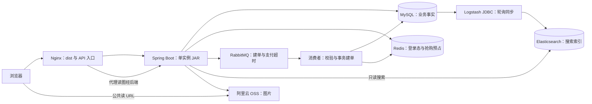

# 项目指南

本仓库是单个 Maven 模块，包名为 `com.dss`。代码基线为远端 main `e79f349`。本文描述源码结构，不证明测试或部署结果。

## 总体架构

Nginx 托管 `/var/www/tikcookie-web/dist`，API 转发到回环 JAR。Compose 只运行 MySQL、Redis、RabbitMQ、ES 和 Logstash；OSS 是外部依赖。开发时 Vite `/api` 代理直接连接后端，不需要发布 dist。

## 源码入口

| 路径 | 职责 |
| --- | --- |
| `src/main/java/com/dss/DssApplication.java` | 启动、调度和上海时区 |
| `common` | 响应、异常、鉴权、分页、配置和图片 URL |
| `user` | 验证码登录、资料和退出 |
| `shop` / `product` | 店铺、分类、商品、内部管理接口 |
| `order` | 普通下单、支付、取消、退款、用券和扫描任务 |
| `flash` | 启动演示轮次、Redis Lua、MQ、请求协调和调度 |
| `favorite` / `review` | 收藏和评价 |
| `search` | ES 查询、文档映射；历史写入辅助类不作为启用链路 |
| `file` | OSS 上传及代理读取 |
| `src/main/resources/application*.yml` | 公共配置和 profile 日志差异 |
| `src/test/java` | 公共契约、鉴权、文件和搜索测试 |
| `dss-init.sql` | 空库六表结构，不是旧库迁移脚本 |

表为 `users`、`shops`、`products`、`orders`、`favorites`、`reviews`。

## 数据与流程

- MySQL 是订单、库存和业务资料的事实来源。订单保存商品与店铺快照。
- 普通订单同步写库。抢购先预占 Redis，再经 MQ 异步建单，最后确认缓存。
- Redis 可预占库存与 MySQL 建单后的库存可能暂时不同，不能直接互相覆盖。
- 取消、建单和补偿使用单 JVM 协调锁，不支持多个后端实例并行运行。
- 搜索使用 `dss_product`、`dss_shop`。Java 仅读取，Logstash 是索引写入方。禁用 Java 启动重建。
- 搜索有延迟，不能作为下单或抢购库存依据。当前商品搜索只返回 NORMAL。
- 图片 `fileId` 是 OSS 对象 key；URL 由 `FileUrlResolver` 生成。代理读图公开，不适合敏感图片。

## 开发顺序

先读 [需求](需求文档.md) 和 [接口](接口文档.md)，再配置依赖、初始化空库、构建和验证。配置见 [CONFIGURATION.md](CONFIGURATION.md)，部署见 [DEPLOYMENT.md](DEPLOYMENT.md)。

改接口时同时更新 Controller、DTO/VO、OpenAPI 和文档。PR 说明兼容性、联调顺序和验证结果。不要将测试文件存在视为测试通过，也不要将构建成功视为部署成功。
